# Aero Ground Station

Hardware implementation, communication and system architecture

Prepared 26 October 2026


## 01. Project purpose and system boundary

A supervised observation and rescue-review prototype


Aero Ground Station combines a small ArduCopter aircraft, an ELRS radio link, an independent analog FPV video link and a Windows laptop. The laptop displays telemetry and video, assists search planning, runs person detection and records candidate rescue incidents. The flight controller remains responsible for stabilization and onboard protective behavior.

The project is intended to assist a trained pilot and a rescue operator. A detector box means a possible person in an image; it does not confirm a survivor, identity, medical condition or exact ground coordinates. A reviewed search route is a request for bounded movement, not evidence that the airspace or terrain is clear.

This pack documents the current application and the hardware discussed during commissioning. It is a technical explanation and implementation record, not a declaration that the aircraft is flight-ready. It includes architecture, interface contracts, UML views, parameter provenance and remaining acceptance work.


- Onboard: sensing, estimation, motor control and flight failsafes.

- On the laptop: interface, AI, route feedback, event storage and review.

- Human authority: takeoff, landing, mode selection, takeover and evidence verification.


**Implementation note:** Documentation date: 26 October 2026. Hardware confirmations are historical observations from this project conversation.


Sources: S11, S12


## 02. Evidence and current implementation status

Separate confirmed behavior, implemented software and unresolved integration


Mission Planner screenshots identified ArduCopter 4.7.1 on SpeedyBeeF405AIO and Mission Planner 1.3.83. The user reported a 4S 650 mAh battery, 3-inch props, a GM10 Mini V3 GPS and iFlight analog goggles. The exact ELRS receiver, transmitter-module firmware, camera, VTX and motor KV remain unrecorded.

The user confirmed radio channels, mode changes, corrected motor order and rotation, and disarmed radio-failsafe detection/recovery. Those are useful bench observations. They do not prove stable flight, correct GPS navigation, an obstacle-safe RTL path or airborne failsafe recovery.

The last recorded software validation on 16 October reported 46 passing tests and actual VisDrone inference on team footage. GPS remained unresolved in the conversation. The analog receiver/capture options were investigated, but purchase and live capture were not confirmed.


Evidence level | Examples

--- | ---

User-confirmed bench | Mode switches, motor order/direction, RC-loss message

Software verified | Upload, decode, AI adapter, policy tests, local playback

Unresolved | GPS fix/heading, current sensing, RF command/latency tests

Proposed only | RC805/EasyCAP purchase, speaker and sensor additions


**Implementation note:** Treat the saved parameter patches as commissioning history. A fresh FC export is needed to prove the present onboard values.


Sources: S11, S12


## 03. Hardware component inventory

Known parts, roles and missing identifiers


The AIO is both a flight-control board and an integrated ESC assembly; it is not the same thing as the entire aircraft. The frame, motors, propellers, power wiring, receiver, navigation sensor and video system complete the aircraft. Each component needs a recorded model, supply requirement, mounting orientation and connection.

Keep a photographed bill of materials with serial numbers where useful. Do not substitute a component solely because its connector fits. Matching protocol, voltage, pinout, frequency and mechanical clearance matters more than a shared product category.


Component | Project record / role

--- | ---

Flight controller / ESC | SpeedyBee F405 AIO V1; ArduCopter + four motor outputs

Propulsion / battery | 3-inch props; 4S 650 mAh 95C; motor KV unconfirmed

Navigation | Flywoo GM10 Mini V3; UART5; compass variant to confirm

RC / telemetry | ELRS aircraft RX + TX module; RadioMaster Pocket reported in notes

FPV observation | Analog camera/VTX + iFlight goggles; exact models unknown

Ground computer | Windows laptop; Mission Planner + local Python application

Video-to-USB hardware | UVC receiver OR analog VRX plus capture; not confirmed purchased


Sources: S01, S03, S11


## 04. AIO and ArduPilot responsibilities

The autopilot firmware lives on the flight controller


ArduPilot is the autopilot software family. ArduCopter is its multirotor firmware, installed on the AIO. It reads inertial/navigation sensors, estimates attitude and position, interprets flight modes and produces motor commands. Integrated ESCs translate those commands into the switching currents that drive brushless motors.

Mission Planner is a ground application used to configure, inspect and command ArduPilot. It is not firmware inside the radio and is not a compulsory forwarding process between our app and the aircraft. Our application can communicate directly with the same autopilot through its own MAVLink adapter.

The SpeedyBee board support page is the reference for the ArduPilot target and board-specific mappings. The AIO has no built-in compass; an external device, if present, must be identified separately. Firmware limitations on an F405 target mean an optional ArduPilot feature should be checked before designing around it.


- AIO hardware provides computing, sensor interfaces and ESC connections.

- ArduCopter provides flight behavior; ELRS transports control and data.

- The laptop never substitutes for the onboard attitude controller.


Sources: S01, S17


## 05. Power, propulsion and energy flow

Separate battery power, regulated electronics power and motor signals


The 4S pack supplies the aircraft power input. Its nominal voltage is 14.8 V and standard full-charge voltage is 16.8 V. The recorded 650 mAh capacity corresponds to 9.62 Wh nominal energy (14.8 x 0.65), not a prediction of usable flight energy or endurance. The 95C label is not a measured system current limit.

The ESC power stage drives the four motors. Regulated rails power flight electronics and suitable peripherals. A UART is a data interface and does not define a peripheral supply voltage. Check the board/manual and the exact receiver or camera before using a power pad.

Battery monitoring has three different roles: measuring voltage/current, estimating consumed capacity and triggering protective actions. USB-only bench power does not provide a valid flight-pack voltage. A plausible voltage display still needs comparison with a charger or meter; percentage estimates depend on capacity/current calibration.


- No endurance claim is justified until mass, hover current and usable capacity are measured.

- Do not power a 12 V-only RC805 directly from a 4S pack.

- Disconnect power before changing motor wires; keep props removed for setup.


**Implementation note:** Historical thresholds: low 14.4 V, critical 14.0 V and arming minimum 14.7 V. These were initial project choices, not universally valid battery specifications.


Sources: S17, S07


## 06. GPS and compass integration

UART position data and I2C heading data are separate interfaces


The user identified the GPS as GM10 Mini V3 and confirmed connection to UART5. The intended data wiring is GPS TX to AIO R5 and GPS RX to AIO T5, plus correct power and common ground. The project changed SERIAL5_BAUD from 57 to 115 (115200 baud); SERIAL5_PROTOCOL=5, GPS1_TYPE=1 and GPS_AUTO_CONFIG=1 already matched.

The module LED colors alone did not establish a valid fix. A useful diagnosis needs fresh GPS_RAW_INT, fix type, satellite count and dilution/accuracy information. A stationary open-sky test, antenna orientation, stable supply, serial communication and RF interference should be investigated systematically rather than changing several parameters at once.

A compass, if included in the module variant, uses separate SDA/SCL connections. The historical parameter export detected an external compass, but this does not establish that it is part of this exact GM10 or that its mounting orientation is correct. Verify level headings in known directions. Do not apply a printed rotation label blindly.


**Implementation note:** GPS fix was still unresolved at the end of hardware troubleshooting. Do not represent Loiter, RTL, GUIDED navigation or fence readiness as demonstrated.


Sources: S03, S01, S10


## 07. End-to-end system architecture

RC, MAVLink telemetry and video use different paths


Read the three paths independently. Manual inputs originate at the pilot handset and arrive at ArduCopter through the ELRS aircraft receiver. MAVLink carries aircraft state in the opposite direction and carries supervised laptop requests toward the FC. Analog video originates in the FPV camera/VTX and needs its own compatible video receiver.

The radio and laptop bridge are ground equipment. The aircraft receiver is not the same component as the 5.8 GHz FPV receiver. The RF band and packet configuration of the installed ELRS hardware must be documented; do not assume they match the video link.


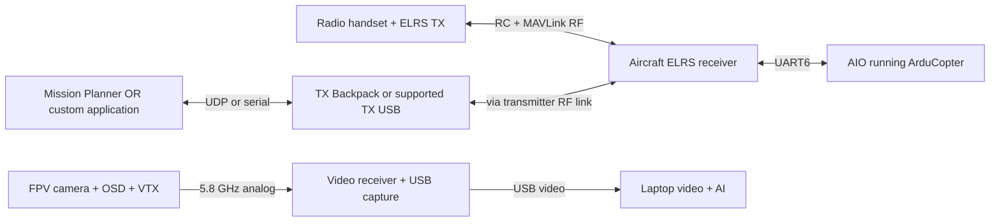

Telemetry is bidirectional. Video travels separately. The laptop bridge depends on the actual transmitter hardware.


Sources: S02, S11


## 08. ELRS link and laptop bridging

Native MAVLink is different from ordinary CRSF telemetry


ExpressLRS is the RF control/data link between a compatible transmitter module and aircraft receiver. This project uses the native MAVLink path, which supports RC plus bidirectional telemetry with compatible hardware/firmware. Conventional CRSF telemetry on the handset is not automatically a laptop MAVLink connection.

For this AIO the project uses UART6 for the receiver, with SERIAL6_PROTOCOL=2 and SERIAL6_BAUD=460. Receiver TX connects to R6 and receiver RX to T6. The chosen stream rates and radio settings must fit the actual RF throughput. RSSI_TYPE=5 is the native-MAVLink configuration used here.

On the ground, a compatible TX Backpack can forward MAVLink over Wi-Fi, commonly to a UDP GCS endpoint. A supported external TX module may expose serial MAVLink over its own USB. The handset USB joystick socket is a different interface. The actual bridge used by this build remains to be recorded, so both supported alternatives are shown rather than claiming a specific one was verified.


**Implementation note:** Recorded application endpoint: udpin:0.0.0.0:14550. This is a configured receive address, not proof of a working wireless link.


Sources: S02


## 09. Wiring and interface register

Record electrical connections separately from logical software links


Use pad labels from the exact AIO revision. TX/RX are crossed between devices because a transmitter output must feed the other device receiver input. Ground reference is required. Connector color order is not a substitute for labelled continuity checks.

The diagram deliberately does not claim a connector pin order. Consult the board and peripheral manuals before soldering. Keep antennas and sensitive GNSS/compass wiring clear of avoidable motor-current and RF interference sources, then verify behavior after final assembly.


Connection | Interface / intended direction

--- | ---

GPS TX / RX | TX -> R5; RX <- T5; UART5 GPS

ELRS receiver TX / RX | TX -> R6; RX <- T6; UART6 native MAVLink

External compass if fitted | SDA <-> SDA; SCL <-> SCL; I2C + correct supply

Laptop service connection | USB -> FC SERIAL0 MAVLink2; COM number is machine-specific

FC to integrated ESCs | DShot600; outputs 1-4 with project remapping

Camera / OSD / VTX | Analog video through appropriate board pads; supply separately verified


Sources: S01, S17, S02


## 10. Aircraft interface diagram

Physical interfaces around the AIO


The flight controller receives navigation and RC information while independently commanding propulsion. A power rail can be shared only within its verified rating; the data connectors do not imply that all peripherals tolerate the same voltage.

The firmware serial number is logical. In this board configuration UART5 is GPS and UART6 is the full bidirectional receiver link. Other boards or firmware targets can use different mappings.


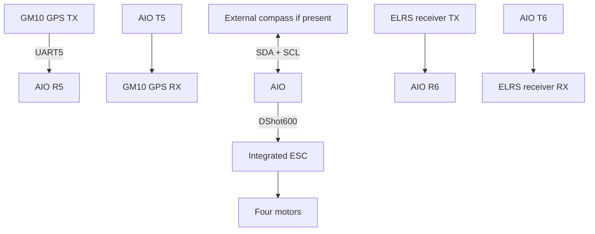

Arrows summarize signal interfaces, not pin order or connector orientation. Check labels and voltage before soldering.


Sources: S01, S17


## 11. UML deployment diagram

Where hardware and software execute


Deployment assigns processes to physical devices. ArduCopter executes on the AIO; Mission Planner, FastAPI, OpenCV and PyTorch execute on the laptop. ELRS firmware executes on the transmitter module/receiver, and optional Backpack firmware executes on the compatible bridge hardware.

In ordinary commissioning only one GCS should own a serial or UDP receive endpoint. To run Mission Planner and the custom application simultaneously, use an explicitly configured MAVLink router/forwarder with distinct endpoints. Two applications competing for one COM port caused access-denied behavior during this project.


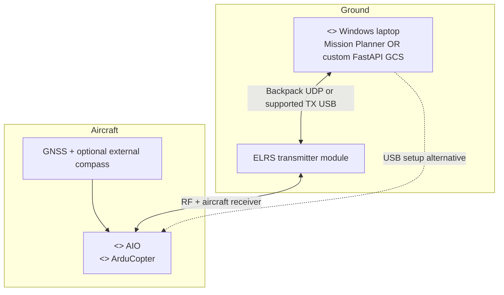

Mission Planner and the custom application are peer GCS clients. Sharing an endpoint requires an intentional router.


Sources: S02, S11


## 12. Manual radio control and modes

A three-position mode switch plus separate auxiliary requests


Channel 6 is the main mode channel. At approximately 1000 it selects Stabilize, at 1500 Loiter and at 2000 GUIDED. The project assigns duplicate neighboring mode slots to make the intended three positions clear: FLTMODE1/2=0, FLTMODE3/4=5 and FLTMODE5/6=4.

Channel 5 high requests RTL (RC5_OPTION=4), channel 7 high requests AltHold (RC7_OPTION=70) and channel 8 high requests Land (RC8_OPTION=18). Channel 6 has no auxiliary function. Begin a mode check with the auxiliary switches low and test one request at a time. Do not assume simultaneous auxiliary switches have a priority order designed for this project.

Manual takeover means selecting an appropriate pilot-controlled mode. Moving sticks in GUIDED is not a general substitute for mode takeover. Stabilize uses manual throttle; Loiter needs a healthy position estimate; switching modes requires a pilot familiar with the resulting controls. The user confirmed mode changes, but a complete in-flight takeover test remains pending.


Parameter | Recorded assignment

--- | ---

FLTMODE_CH | 6

FLTMODE1 / 2 | 0 / 0: Stabilize

FLTMODE3 / 4 | 5 / 5: Loiter

FLTMODE5 / 6 | 4 / 4: GUIDED

RC5 / RC7 / RC8_OPTION | 4 RTL / 70 AltHold / 18 Land


Sources: S09


## 13. Motor order and rotation

The corrected mapping differs from the original export


Motor test letters indicate test sequence, not output channel numbers. After user-observed motor tests, outputs 2, 3 and 4 were reassigned. The user then confirmed the expected locations and spin directions shown below. This mapping is specific to this physical build and must not be transferred to another assembly.

The recorded protocol is DShot600 (MOT_PWM_TYPE=6); DShot does not use analog ESC throttle calibration. Correct test rotation does not prove a suitable motor idle, full-range ESC behavior, propeller installation, thrust balance or a safe tune. The motor KV, exact motor model, total mass and thrust margin still need a measured record.


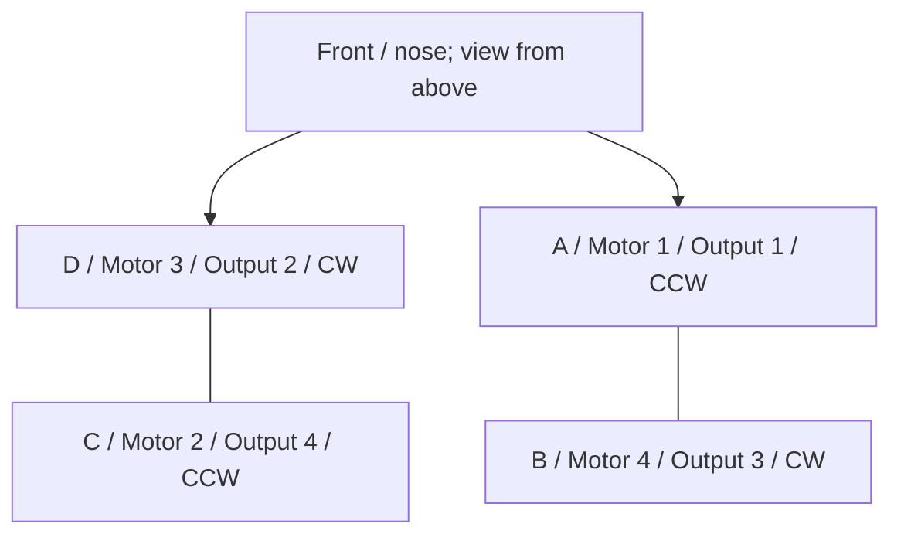

The user confirmed these positions and directions after remapping. Test letters, motor numbers and physical outputs are different identifiers.


**Implementation note:** Do not reload the old complete hello123 export over the corrected build; it contains the original SERVO output assignments.


Sources: S08


## 14. Mission Planner commissioning workflow

Configuration, diagnostics and readback on the ground


Mission Planner is used to select firmware target, inspect parameters, calibrate sensors and radio ranges, configure modes, test motors and inspect messages/logs. Configuration changes must be written, followed by any required reboot and a fresh parameter readback. A green UI value is not necessarily proof that every related setting was saved.

The project encountered a loader exception and a range warning during imports. The initial 3-inch pitch/roll acceleration estimate exceeded the documented range; the generated file was corrected to 1800 for ATC_ACC_P_MAX and ATC_ACC_R_MAX. This is a starting estimate, not a flight-derived tune.

Maintain three artifacts: the original export, a reviewed list of intended changes and a fresh post-reboot export. Record firmware version with each. Calibration and motor mapping are aircraft-specific, so a small reviewed patch is preferable to indiscriminate reuse of a donor setup.


- Remove props for powered setup and motor testing.

- Check board orientation, radio calibration and external compass installation.

- Confirm battery sensing before relying on voltage compensation or failsafes.

- Inspect pre-arm errors rather than suppressing checks.


Sources: S18, S11


## 15. MAVLink telemetry contract

Messages consumed by the current adapter


The adapter only accepts the configured aircraft system/component IDs, defaulting to 1/1. It records monotonic reception times per message family. The application itself sends a GCS heartbeat about once per second with source system 255 and component 190. Those IDs must be considered if other GCS software is also running.

The application checks heartbeat, position, GPS, battery and EKF age separately before movement. Position and heading are decoded from GLOBAL_POSITION_INT; battery percentage is taken from SYS_STATUS when supplied by the FC. Missing values remain unknown rather than being inferred from video OSD.

Message transport does not establish correctness of sensor inputs. Stale, inconsistent or unavailable navigation state must remain visible. Higher message rates are useful only when the RF link can sustain them without excessive buffering and loss.


Message | Fields used

--- | ---

HEARTBEAT | Mode and armed state

GLOBAL_POSITION_INT | Latitude, longitude, relative altitude, speed, heading

GPS_RAW_INT | Fix type and satellite count

SYS_STATUS | Battery voltage and remaining percentage

EKF_STATUS_REPORT | Estimator readiness flags

ATTITUDE / SCALED_PRESSURE | Attitude; available barometer temperature

STATUSTEXT / RADIO_STATUS | Flight messages; link diagnostics


Sources: S10, S11


## 16. UML telemetry sequence

State moves from the FC to the interface


The browser does not open the aircraft serial port. It subscribes to the local server, which reads snapshots supplied by the telemetry worker. This keeps aircraft communication independent from browser rendering and AI workloads.

A fresh heartbeat only proves that a heartbeat arrived. It cannot substitute for fresh absolute position, valid battery measurement or estimator readiness. All displayed timestamps should be interpreted as reception age, not a measurement of over-air latency.


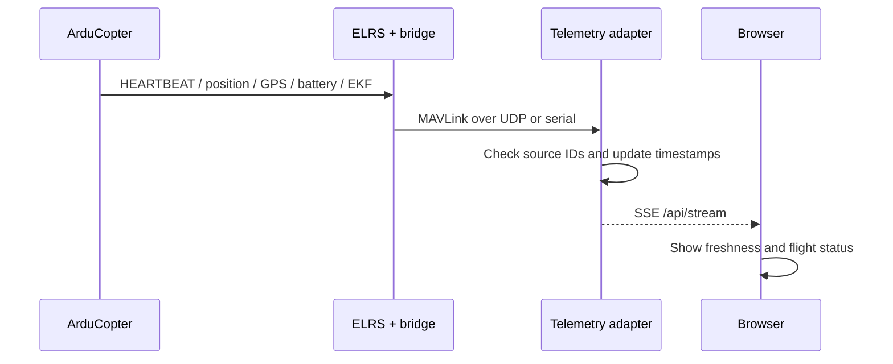

Freshness is tracked per message family. A fresh heartbeat alone does not establish fresh GPS, battery or EKF data.


Sources: S10, S11


## 17. GUIDED movement and control authority

The laptop sends setpoints; the FC stabilizes flight


The implementation sends SET_POSITION_TARGET_LOCAL_NED with MAV_FRAME_BODY_NED and velocity-only mask 0x0DC7 (3527). Its body axes are forward, right and down; an upward command therefore uses negative vertical velocity. The onboard autopilot interprets the request only in a suitable mode and closes the attitude/motor-control loops.

The operator renews a control lease every second; it expires after three seconds. Manual app requests last at most one second and the UI normally asks for 0.5 seconds. Initial application speed is 0.5 m/s. Neither a sent packet nor an HTTP success establishes physical motion; velocity targets do not carry COMMAND_ACK in this usage.

This application does not arm, select GUIDED, take off, land or upload an onboard mission. The operating concept is manual takeoff and stable hover, deliberate GUIDED selection, supervised laptop requests and radio takeover. The model and route generator have no authority to bypass the state gates.


**Implementation note:** Live control defaults to false. Physical behavior and reliable response require separate SITL/bench/flight acceptance.


Sources: S04, S11


## 18. UML command sequence

Requests cross safety gates before reaching the radio


A UI action first passes local HTTP validation and station policy. An accepted request is encoded into MAVLink, sent over the selected endpoint and interpreted by ArduCopter. The return telemetry path supplies observed position/mode state.

On a pilot mode change away from GUIDED, the application clears its lease and stops issuing velocity requests. A mode change can occur before the next laptop heartbeat is processed; onboard mode handling is therefore the primary authority boundary, not a browser response time.


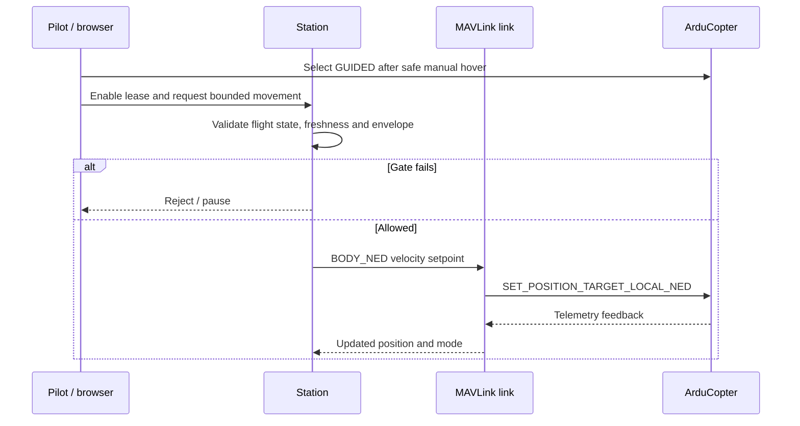

Velocity setpoints have no COMMAND_ACK. The application observes telemetry; the FC closes the stabilization loop.


Sources: S04, S11


## 19. Analog video acquisition

The goggles and telemetry radio do not automatically feed laptop video


The aircraft camera supplies analog video, optionally through the FC OSD, to the VTX. The iFlight goggles receive the RF image, but no usable AV/USB output was confirmed for this exact model. Their memory-card slot is for recording/storage, not a general live video output.

Two candidate ground routes were discussed. A USB UVC analog receiver combines RF reception and USB conversion. Alternatively, an RC805-style analog receiver provides composite video to a separate EasyCAP-style USB capture adapter. These are candidates, not confirmed purchases or tested capture devices.

The eight-channel RC805 must match an exact supported VTX frequency: 5705, 5685, 5665, 5645, 5885, 5905, 5925 or 5945 MHz. It is not enough that both products say 5.8 GHz. Its listing specifies 12 V power; the capture adapter gets USB power. Check AV connector pinout/cable and actual Windows driver compatibility.


- UVC route: VTX -> analog USB receiver -> laptop.

- Composite route: VTX -> RC805 -> composite capture -> laptop.

- Goggles may receive the same broadcast independently.


**Implementation note:** No new component prices or stock claims are made in this pack; availability changes and was not re-quoted.


Sources: S13, S14


## 20. Video formats and timing

Preserve source information and measure complete latency


A capture device may expose PAL 720x576 at 25 fps or NTSC 720x480 at approximately 30 fps. These are seller-described modes for the investigated capture adapter, not measured support from a purchased device. Start with the camera/capture standard and verify frame shape, color and stable sync. A higher requested resolution does not add analog source detail.

The application uses OpenCV capture and MJPEG delivery. Its reported capture-frame age begins at the software read, while inference time describes model processing. Neither includes the entire camera-to-VTX-to-RF-to-capture-to-display chain. Measure end-to-end delay with a visible timer or LED comparison.

Capture and inference run independently. Inference processes a recent frame rather than building an ever-growing queue. Annotated detection video uses the analyzed source frame. Raw recording remains available independently; slower inference means skipped source frames, not a claim of full-rate recognition.


Sources: S14, S11


## 21. UML use cases and operator roles

Pilot and rescue operator have distinct responsibilities


The pilot is responsible for flight readiness, manual control, mode selection and landing. The rescue operator reviews sensor information, proposes a search, validates route limits and verifies candidate incidents. These roles may be held by one trained person in a bench demonstration, but their responsibilities remain distinct.

The app can advise hold or pause a running supervised mission under an explicitly enabled person policy. It cannot declare that the site is obstacle-free or that a detected object is a confirmed survivor. Incident evidence and actions require human interpretation.


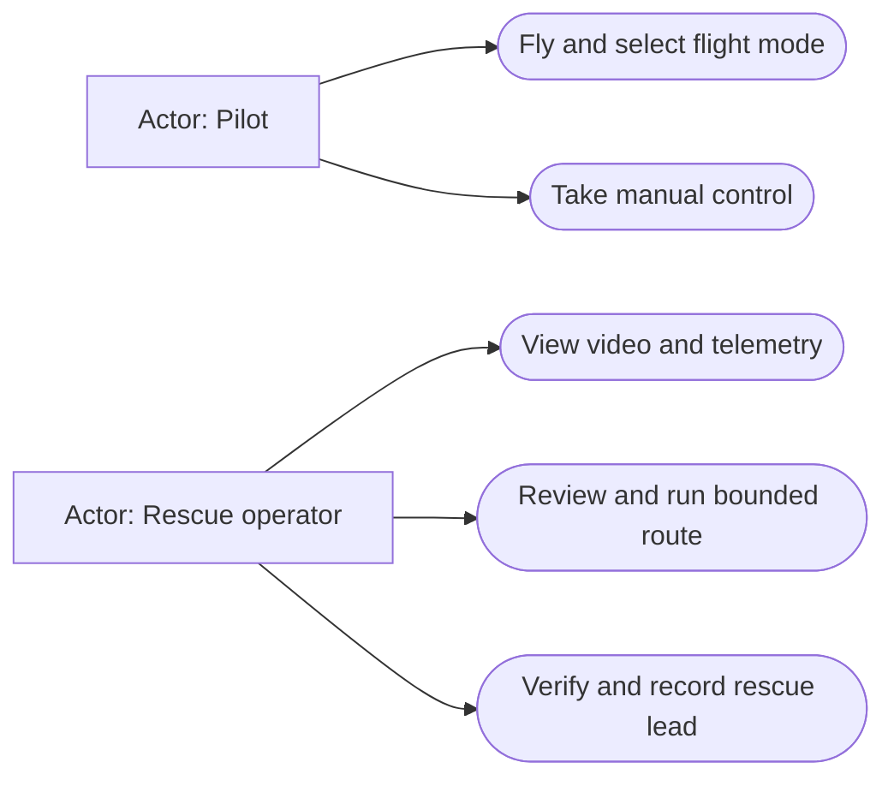

Search assistance does not replace pilot authority or human verification of a potential survivor.


Sources: S11


## 22. Application component architecture

Existing modules and their communication


FastAPI validates requests and serves the interface. Station coordinates telemetry, video, movement gates, mission execution, intelligence, recording and storage. The browser receives status through SSE and video through MJPEG; write actions carry a random per-process token and are restricted by same-origin and Host checks.

The software remains local by default. Optional online map layers make network requests for background tiles, but detection and the bounded intent planner do not need a cloud model. Do not expose the control server to a public interface without a separate access-control design. Incoming UDP MAVLink is not authenticated by this adapter.


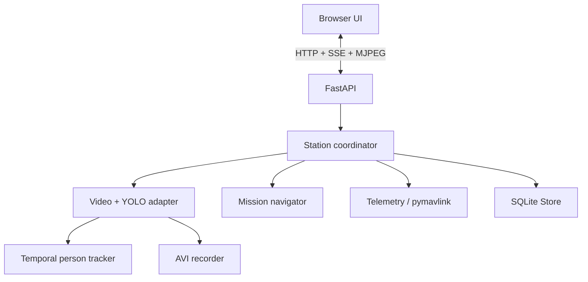

Independent workers keep capture, inference and telemetry from waiting on one another. The station owns policy decisions.


Sources: S11


## 23. UML runtime class diagram

Implementation classes and data ownership


Config validates operating mode, flight envelope and detector options. Telemetry owns MAVLink decoding. Video owns capture and analysis workers. YoloDetector adapts model output into normalized boxes. Intelligence tracks image-space candidates. Mission computes bounded waypoint velocity; Store and Recorder preserve evidence.

The class view is intentionally condensed. Mission and Telemetry are separate classes, as are Store and Recorder, even where grouped in a diagram box to retain readability. The editable Mermaid source contains the individual ownership relationships for a more detailed rendering.


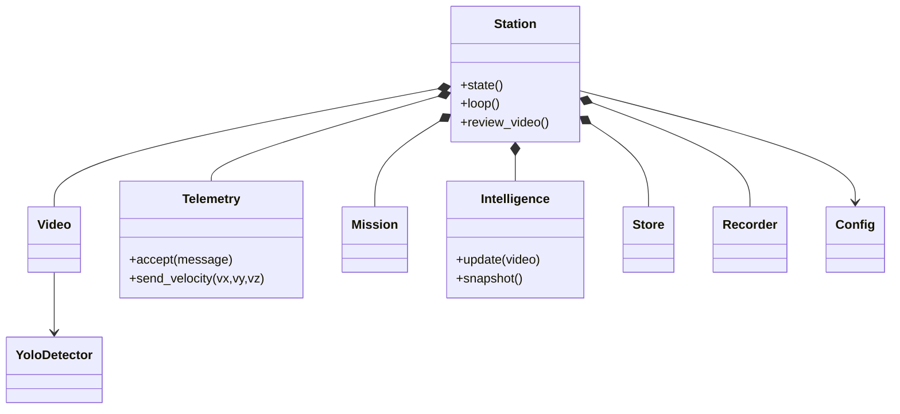

This is a condensed implementation class view; function names reflect the Python application rather than hypothetical modules.


Sources: S11


## 24. AURA model and enhancement integration

Aerial model, lightweight alternative and explicit processing choices


The team integration is pinned to upstream commit d50829119b598e5b32b352f384fdd25aca367f08. A downloader verifies SHA-256 checksums before using local checkpoints. The integrated models are YOLOv8m VisDrone and YOLO26n COCO. The recorded VisDrone checkpoint has no verified CBAM blocks; the pack does not claim CBAM inference.

VisDrone labels pedestrian and people are mapped to the existing person policy while retaining their original labels. Classical CLAHE and FPV hybrid enhancement are optional model-input transformations. They are not a learned accuracy guarantee. Original imagery remains important evidence for operator comparison.

Optional OSD exclusion is a calibrated geometric post-filter. It can hide real objects overlapping telemetry graphics, so it is off by default and requires a matching profile. The included profile applies to one source layout, not every camera. Detector failures are surfaced explicitly; a selected broken YOLO model is not silently replaced by HOG.


- CPU FP32 is the installed baseline; compatible CUDA use is configurable.

- The earlier recorded CPU timing was roughly 230-320 ms per warmed result.

- That observation is not a benchmark across all clips or a measure of aerial accuracy.


Sources: S11, S12


## 25. Uploaded-video test workflow

Local video testing does not open a drone-control connection


The operator chooses a local file, detector and enhancement, then uploads through the existing app. The server accepts supported containers up to 500 MB, checks authentication and decodability, and only permits source replacement in demo mode. Recordings must be stopped before swapping the source.

A source change clears the control lease and old person tracks and pauses any simulated mission. Playback loops at the source rate; AI uses the newest available frames. Annotated MJPEG preserves frame-to-box alignment and reports inference age. The displayed flight telemetry in this mode is simulated, even though the video and model inference are real.


```mermaid

sequenceDiagram
 actor O as Operator
 participant API as FastAPI
 participant V as Video + YoloDetector
 participant I as Intelligence
 O->>API: POST /api/video/upload
 API->>API: Authenticate; require demo; validate video
 API->>V: Load source, model and enhancement
 loop Newest available frame
 V->>V: Decode + optional enhancement + YOLO
 V->>I: Normalized timestamped detections
 V-->>O: Frame-matched annotated MJPEG
 I-->>O: Persistent candidate evidence
 end


```

Uploaded footage is a local test input. Aircraft telemetry remains simulated and no MAVLink connection is opened.


Sources: S11, S12


## 26. Person evidence, tracking and decisions

Temporal persistence reduces single-frame triggers


Normalized boxes are associated using image-space intersection over union. The existing tracker requires three distinct matched detection frames before calling a track persistent. A track expires after about 1.5 seconds without updates; a confirmed candidate must also have been seen recently, within about 0.8 seconds.

Advisory mode presents evidence. The optional pause-on-person policy pauses an active mission when a persistent candidate is present and creates an incident with a cooldown. It does not identify the person, infer injuries or establish a victim position. The recorded aircraft coordinates are context about the camera platform.

Slow CPU inference, analog interference, high altitude, small objects and camera angle can all reduce useful evidence. Counted boxes across frames are not unique people. Camera calibration, synchronized pose and terrain/ranging data would be needed for defensible image-to-ground geolocation.


- Do not interpret HOG scores as probabilities.

- Keep original class labels and source frame IDs in review evidence.

- Auto-pause recovery remains latched until explicit operator action.


Sources: S11, S12


## 27. Mission activity and route feedback

GPS waypoints are followed by a laptop controller


The app validates 1-100 WGS84 points with relative altitude and hold time against its configured radius/ceiling. Its local grammar can propose search grids, perimeters, orbit-like routes and bounded movements. It is a deterministic intent parser, not an unrestricted language-model pilot.

The navigator computes north/east/vertical error to the next point, limits speed, rotates horizontal velocity by current heading and streams body-frame requests. Arrival uses approximately 0.6 m horizontal and 0.4 m altitude tolerances in the present implementation. Those tolerances require real positioning-performance assessment; ordinary GPS must not be assumed to achieve them reliably.


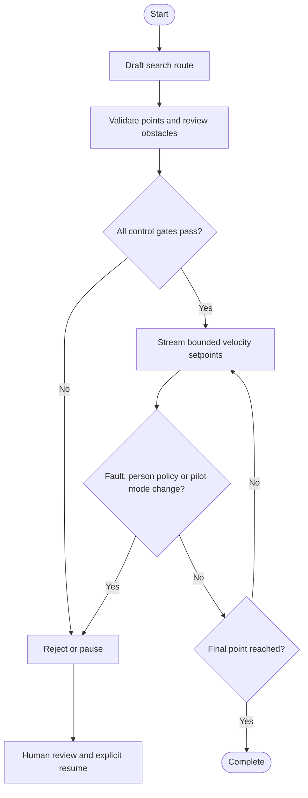

Fault, person-policy and pilot events pause the route. Human review and an explicit resume action are required.


**Implementation note:** This route is not an onboard AUTO mission. The app does not upload takeoff/land items, provide obstacle avoidance or evaluate terrain clearance.


Sources: S11


## 28. Mission state and recovery

Pause is a latched state, not automatic fault recovery


Loading a validated route creates ready state. Start begins at the first point. Operator pause, unavailable prerequisites or person policy can produce paused state. Resume requires current prerequisites and an explicit request; cancelling terminates the current route execution.

Editing a paused plan creates a new ready plan. Automatic return of a good signal does not mean the earlier action should resume. The distinction is important after pilot intervention, low battery, video loss or a person lead that requires review.


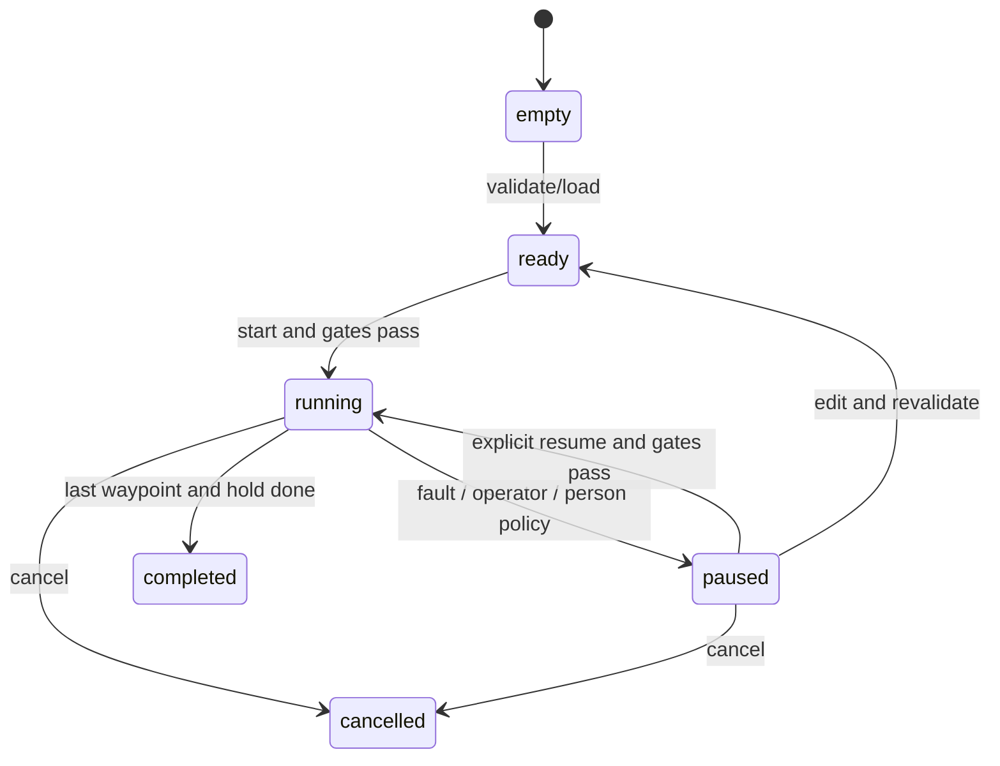

Editing a paused route loads a new ready plan. Start begins at point one; Resume continues the paused route.


Sources: S11


## 29. Incident storage and data model

Evidence is stored locally with explicit provenance


SQLite stores events as id, UTC time, kind and JSON payload, and stores missions as id, name and plan JSON. Incident entries can reference a JPEG snapshot and the aircraft position available at that time. The raw AVI recorder runs independently with bounded duration/storage; video uploads remain separate local files.

The application supports event/log export and route JSON/GeoJSON/WPL exchange with defined limitations. A WPL export is not proof that it was uploaded to or accepted by a vehicle. Data retention is manual, and uploaded footage can contain people or locations, so sharing the code repository is different from publishing the local evidence directory.


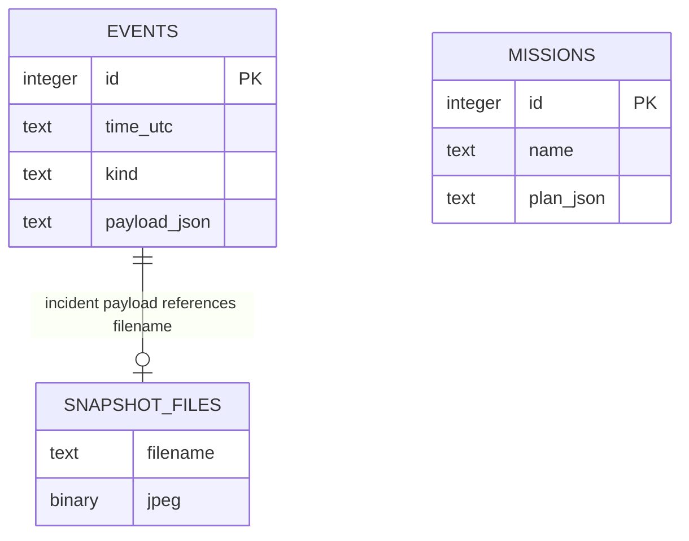

Incidents are JSON payloads in events, not a separate incident table. Positions describe the aircraft, not an inferred victim.


Sources: S11


## 30. Safety gates and onboard failsafe layers

Protective logic belongs both onboard and in the application


App live control requires enabled configuration, an operator lease, fresh heartbeat/position/GPS/battery/EKF, GUIDED mode, armed state, a 3D fix, estimator readiness, sufficient battery, valid altitude/radius and fresh video. Current age limits are 2.5 seconds for core telemetry and 1 second for video. Defaults are 0.5 m/s, 30 m altitude and 50 m radius.

Onboard RC, GCS, battery and estimator failsafes operate independently from those application gates. The historical settings include FS_THR_ENABLE=1, FS_GCS_ENABLE=1, FS_GCS_TIMEOUT=5, FS_OPTIONS=16 and GUID_TIMEOUT=3. FS_OPTIONS=16 permits continued pilot-controlled operation on GCS loss; it is not a general instruction to continue GUIDED flight.

RC loss and GCS loss are separate failure events even when they share an RF system. A disarmed test that produces a failsafe message establishes detection, not the resulting airborne trajectory. Other GCS heartbeats can affect a laptop-loss test. Verify behavior with a controlled procedure and logs.


**Implementation note:** Application home/radius checks are not a replacement for the onboard fence. The project fence parameters were staged with FENCE_ENABLE=0.


Sources: S11, S05, S06


## 31. Parameter register and provenance

Historical changes grouped by purpose; read back before relying on them


The original hello123 export contained 1,098 entries. Subsequent small files changed battery protection, telemetry streams, modes, navigation speeds, fence limits, motor mapping, GPS baud and initial tuning. The earlier combined setup patch did not contain later motor/GPS/tuning changes. These files must not be treated as interchangeable complete current-state exports.

A fresh FC parameter export should be compared with this register and the physical build. The pack deliberately does not provide a new flight-ready all-parameter import because current GPS readiness, sensor calibration and airborne behavior are not verified.


Purpose | Recorded project values

--- | ---

Battery sensing | Monitor 4; volt pin 10; current pin 12; multiplier 11; scale 39.4

Battery protection | Capacity 650; low 14.4 V / RTL; critical 14.0 V / Land; arm 14.7 V

GPS / ELRS | SERIAL5=GPS at 115200; SERIAL6=MAVLink2 at 460800

Telemetry | MAV2 EXT_STAT/POSITION/EXTRA1-3/RAW_SENS/RC_CHAN = 1 Hz

Speed / fence staging | Loiter 2 m/s; WP 1 m/s; RTL 2 m/s; radius 50 m; max 30 m; fence OFF

Initial tuning | Pitch/roll accel 1800; yaw 333; gyro filter 115 Hz; thrust expo 0.41

Preserve | Calibration, verified motor map and radio mapping; no skipped arming checks


**Implementation note:** MOT_BAT_VOLT_MIN=13.2 V is a compensation bound, not the chosen critical landing threshold. Do not confuse the two.


Sources: S11


## 32. Commissioning and field workflow

Progress through evidence-based acceptance stages


Begin with a complete build inventory, backups and propellers removed. Establish correct board orientation, radio calibration, motor order/direction, sensor installation and valid battery measurement. Resolve GPS communication and navigation readiness before evaluating position-dependent modes.

Next verify USB telemetry, then wireless telemetry using the actual bridge. Validate video capture separately from detection. Use SITL or an appropriate controlled rig for movement-axis interpretation, command timeout and mode-takeover behavior. Only after ground acceptance should a trained pilot conduct a manual outdoor hover and log review in a suitable clear area.

For application flight, establish a safe manual hover, select GUIDED deliberately, review the route and enable the control lease. Keep the pilot ready for mode takeover. After a fault, pause and assess rather than automatically resuming. Land through the pilot/onboard mode procedure and review logs, evidence, battery consumption and latency.


- Ground acceptance: electrical, mechanical, sensor, RC and telemetry checks.

- Flight acceptance: stability, vibration, hover current, GPS quality, takeover and protective behavior.

- Application acceptance: freshness gates, bounded movement, video loss and incident policy.


Sources: S11, S18


## 33. Test matrix and remaining measurements

Software tests do not certify physical flight behavior


The last recorded automated run reported 46 passing tests. It covered control gating, MAVLink encoding/decoding, route validation, tracking, upload behavior and local evidence generation. Actual inference on one team FPV sample established that the model loads and returns detections, not its precision, recall or performance over disaster scenes.

For every physical acceptance test, record configuration/version, setup, expected result, observed result, pass/fail and evidence filename. Test one independent fault at a time. Record separate timings for camera-to-display delay, inference throughput, command-to-observed-response delay and mode takeover.


Test | Current evidence / next measurement

--- | ---

Motor mapping / mode selection | User confirmed on bench; retain a labelled build record

RC-loss detection | Message appeared and cleared while disarmed

GPS / compass | Fix and level-heading verification unresolved

Battery | Plausible 14.95 V once shown; external comparison/current still needed

AI upload | Software/browser verified; task accuracy unmeasured

Wireless command / GCS loss | Controlled link-loss response and logs still required

Manual flight / endurance | Stable hover, vibration, power and duration not demonstrated here


Sources: S11


## 34. Troubleshooting by subsystem

Use a discriminating check before changing parameters


GPS: distinguish no receiver data from a detected receiver with poor fix. Confirm stable supply, TX/RX crossing, UART5 assignment and fresh GPS telemetry; then test antenna-up outdoors away from interference. Obtain satellite count/fix/accuracy rather than relying on LED colors. A compass can be detected while GPS serial data is still wrong.

Battery: USB-only near-zero pack voltage is expected when the battery input is unpowered. With a pack connected, compare against a meter/charger before adjusting scale. A low-arming-voltage error is not a reason to bypass arming checks. Radio: verify ELRS connection, moving channel bars and the transition into/out of failsafe.

Laptop/video: close competing applications before opening a COM port or camera. Check the exact RF video frequency, capture standard, data cable and driver. An HDMI-only adapter does not accept composite video. AI: verify dependencies, local weights/checksums, source decodability and warm-up status; test the lightweight model if processing cannot keep up.


- Preserve one known-good baseline and change one variable per diagnostic step.

- Use current STATUSTEXT and FC logs; old UI messages can outlast a transient condition.

- Do not infer a live GPS position from map centering or cached coordinates.


Sources: S11, S03


## 35. Disaster-management extensions

Feasible additions and their boundaries


The easiest software additions are operator-confirmed incident status, priority, notes, revisits and a mission evidence report. A future coverage view should state its assumptions; the aircraft track alone does not prove the camera observed every point in a search area.

A small prerecorded-announcement prototype could use ESP32/XIAO, DFPlayer Mini, storage and a lightweight speaker. An alternative is an I2S amplifier with an ESP32S3. Send a selected message ID over a separately engineered command path rather than trying to stream voice through the existing telemetry link. Measure intelligibility against propeller noise and verify regulator/payload margin.

A stationary ground SOS unit avoids adding aircraft mass and can use a button, acknowledgement light and optional microphone. Marker release or supply delivery would need payload/thrust, release-output and safe-drop testing. None of these add-ons are installed or integrated in the current application.


- Prioritize incident workflow before extra airborne payload.

- Treat long-range Wi-Fi, airborne speech recognition and live two-way audio as research tasks.

- Document each proposed addition separately from the confirmed build.


Sources: S15, S16, S11


## 36. Limitations, glossary and viva questions

Explain the design without overstating capability


Current limits: unresolved physical GPS readiness, unverified end-to-end live video acquisition, no onboard mission upload, no automatic arming/takeoff/landing, no obstacle avoidance, no exact victim geolocation and no validated rescue-scene accuracy benchmark. AI candidates require human review. A smartphone/ESP32 addition does not remove those limits.

AIO means all-in-one board; FC is flight controller; ESC is electronic speed controller; GCS is ground control station; GNSS is satellite navigation; EKF is the state estimator; UART is a serial interface; MAVLink is a message protocol; ELRS is the RC/RF ecosystem; VTX/VRX are video transmitter/receiver; OSD is an image overlay; UVC is a USB video-device interface.

Why both Mission Planner and our app? Mission Planner commissions and diagnoses the FC; our app adds search/vision/incident workflows. Where does AI run? On the laptop. Why separate video and telemetry? They use different sensors, links and interfaces. Why does GPS matter? Current GUIDED navigation uses position/heading feedback. Why is a person box not a coordinate? Projection needs calibrated geometry, synchronized pose and terrain/ranging.


Sources: S11


## 37. References and source register

Trace implementation details to project evidence and primary documentation


Primary evidence: this project conversation, its screenshots and user-reported bench results; the hello123 parameter export and later commissioning patches; the application Python/JavaScript source; docs/COMMISSIONING.md and docs/AURA_INTEGRATION.md; the 16 October software verification record.

Documentation assembled on 26 October 2026. Board wiring and firmware behavior must be checked against the exact installed revision. Source links are references, not evidence that the documented hardware was purchased or that all optional firmware features are available. Keep a post-reboot FC export and measured acceptance record with the final report.


Sources: S01, S02, S03, S04, S05, S06, S07, S08, S09, S10, S11, S12, S13, S14, S15, S16, S17, S18


## Linked references

- S01: [ArduPilot: SpeedyBee F405 AIO board support](https://ardupilot.org/copter/docs/common-speedybeef405aio.html)

- S02: [ExpressLRS: native MAVLink setup and laptop bridging](https://www.expresslrs.org/software/mavlink/)

- S03: [Flywoo: GOKU GM10 Mini V3 GPS specifications](https://flywoo.net/products/goku-gm10-mini-v3-gps)

- S04: [ArduPilot: Guided movement command frames and masks](https://ardupilot.org/dev/docs/copter-commands-in-guided-mode.html)

- S05: [ArduPilot: GCS failsafe](https://ardupilot.org/copter/docs/gcs-failsafe.html)

- S06: [ArduPilot: radio failsafe](https://ardupilot.org/copter/docs/radio-failsafe.html)

- S07: [ArduPilot: battery failsafe](https://ardupilot.org/copter/docs/failsafe-battery.html)

- S08: [ArduPilot: motor connection and motor-test diagrams](https://ardupilot.org/copter/docs/connect-escs-and-motors.html)

- S09: [ArduPilot: radio mode-switch configuration](https://ardupilot.org/copter/docs/common-rc-transmitter-flight-mode-configuration.html)

- S10: [MAVLink: common message definitions](https://mavlink.io/en/messages/common.html)

- S11: [Application repository](https://github.com/rithinreddy0/aero-ground-station)

- S12: [Team AURA source, pinned integration revision](https://github.com/7-Azhar/major_project/tree/d50829119b598e5b32b352f384fdd25aca367f08)

- S13: [RC805 candidate receiver specification](https://rcmumbai.com/products/rc-805-5-8ghz-8-channel-av-receiver)

- S14: [EasyCAP candidate capture-adapter specification](https://probots.co.in/easycap-a072-usb-2-0-audio-video-capture-adapter.html)

- S15: [DFRobot: DFPlayer Mini audio module](https://www.dfrobot.com/product-1121.html/)

- S16: [Seeed Studio: XIAO ESP32S3 family](https://wiki.seeedstudio.com/xiao_esp32s3_getting_started/)

- S17: [SpeedyBee manufacturer board manual](https://spcdn.speedybee.cn/cdn/58507926851031040.pdf)

- S18: [ArduPilot: initial flight tuning](https://ardupilot.org/copter/docs/setting-up-for-tuning.html)